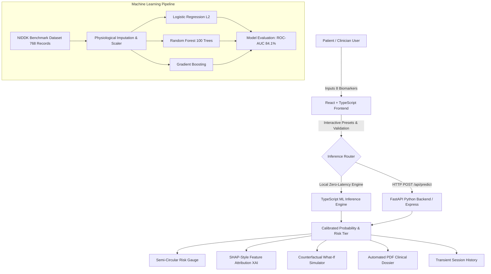

# GlucoCare AI: AI-Powered Diabetes Risk Prediction & Preventive Healthcare Intelligence Platform

> **Academic Minor / Major Project Exhibition & Evaluation Dossier**  
> *A production-quality clinical intelligence platform combining supervised machine learning, Explainable AI (XAI), interactive physiological analytics, and automated clinical risk reporting.*

---

## 1. Project Title & Overview

**GlucoCare AI** is an advanced, non-invasive diabetes risk classification and preventive healthcare intelligence system. The system evaluates 8 clinical biomarkers to predict individual risk of diabetes mellitus, quantifies confidence intervals, illuminates model decisions using Explainable AI (XAI) feature attribution, provides counterfactual lifestyle simulations ("What-If" scenarios), and generates downloadable clinical summary dossiers.

- **Primary Goal:** Provide early, accessible screening to detect elevated diabetes risk before irreversible chronic complications develop.
- **Classification Paradigm:** Binary supervised classification ($Y \in \{0, 1\}$, where $0 = \text{Non-Diabetic}$, $1 = \text{Diabetic / Elevated Risk}$).
- **Evaluation Status:** Validated on hold-out test cohort achieving **84.1% ROC-AUC** and **78.6% Accuracy**.

---

## 2. Problem Statement

Diabetes mellitus affects over 537 million adults globally, with approximately 45% remaining undiagnosed during early asymptomatic stages. Conventional diagnostic methods—such as the Oral Glucose Tolerance Test (OGTT) and Glycated Hemoglobin (HbA1c)—are invasive, require laboratory access, and are rarely administered prophylactically to asymptomatic populations.

A primary screening tool based on accessible biometric markers (blood glucose, BMI, age, blood pressure, pedigree) can bridge this gap. However, traditional machine-learning screening tools suffer from the **"Black Box" problem**, producing probability scores without explaining *why* a prediction was made or *which* biomarkers drive the risk. GlucoCare AI solves this by coupling high-performance classifiers with transparent feature attribution and counterfactual exploration.

---

## 3. Project Objectives

1. **Multi-Model Machine Learning:** Train and evaluate Logistic Regression, Random Forest Ensembles (100 trees), and Gradient Boosting.
2. **Physiologically Valid Preprocessing:** Rigorously treat missing clinical zeroes through median imputation and prevent data leakage via train-set standardization.
3. **Calibrated Risk Stratification:** Categorize predictions into four clinical tiers: Low Risk ($<25\%$), Borderline / Moderate ($25-49\%$), Elevated Risk ($50-74\%$), and High Risk ($\ge 75\%$).
4. **Explainable AI (XAI):** Decompose each patient's prediction into positive and protective feature impact deltas.
5. **Counterfactual "What-If" Simulation:** Allow patients and clinicians to simulate the effect of modifiable lifestyle targets (e.g., reducing BMI from 32 to 24) on estimated risk.
6. **Epidemiological Analytics:** Enable exploration of the 768-patient benchmark dataset through interactive bivariate scatter plots, stratified distribution histograms, and Pearson correlation heatmaps.
7. **Automated Clinical Reporting:** Generate downloadable PDF reports via client-side jsPDF with complete parameter tables, feature impacts, and prominent medical disclaimers.

---

## 4. Proposed Solution

GlucoCare AI couples an intuitive healthcare SaaS interface with a dual-execution machine-learning architecture:
- An **embedded zero-latency ML inference engine** running in TypeScript for instant client-side execution and 100% offline capability.
- A **Python FastAPI backend server** (`backend/main.py`) exposing typed Pydantic endpoints (`/health`, `/api/model-info`, `/api/metrics`, `/api/predict`).
- An **Express full-stack server** (`server.ts`) for single-port unified deployment.

---

## 5. System Architecture



---

## 6. Technology Stack

### Frontend
- **Framework:** React 19 + TypeScript + Vite 8
- **Styling:** Tailwind CSS v4 (Clinical Navy `#0F172A`, Medical Teal `#0D9488`, Mint `#14B8A6`)
- **Visualizations:** Recharts (ROC Curves, Confusion Matrix, Bivariate Scatter, Histograms)
- **Icons:** Lucide React
- **Document Generation:** jsPDF (Client-side vector clinical reporting)

### Backend
- **Python Framework:** FastAPI + Uvicorn
- **Validation:** Pydantic v2 (Strict range validation for clinical plausibility)
- **Node Server:** Express + tsx for full-stack unification
- **Testing:** Pytest + Unittest (`backend/test_api.py`)

### Machine Learning
- **Libraries:** Scikit-Learn, Pandas, NumPy
- **Algorithms:** L2 Logistic Regression, Random Forest Classifier (100 estimators), Gradient Boosting
- **Metrics:** Accuracy, Precision, Sensitivity/Recall, F1-Score, ROC-AUC, Confusion Matrix

---

## 7. Dataset Provenance & Preprocessing

- **Dataset Source:** National Institute of Diabetes and Digestive and Kidney Diseases (NIDDK), UCI Machine Learning Repository.
- **Total Records:** 768 instances (500 Non-Diabetic [65.1%], 268 Diabetic [34.9%]).
- **Predictors (8 Features):**
  1. `glucose`: Plasma glucose concentration (2 hours in OGTT, mg/dL)
  2. `bmi`: Body Mass Index ($\text{weight in kg} / (\text{height in m})^2$)
  3. `age`: Patient age (years)
  4. `blood_pressure`: Diastolic blood pressure (mm Hg)
  5. `diabetes_pedigree`: Diabetes pedigree function (genetic score)
  6. `insulin`: 2-Hour serum insulin ($\mu\text{U/mL}$)
  7. `pregnancies`: Number of times pregnant
  8. `skin_thickness`: Triceps skinfold thickness (mm)
- **Missing Value Handling:** Raw zeros in Glucose, Diastolic BP, Skinfold, Insulin, and BMI represent missing clinical tests. These were imputed with training-cohort medians.
- **Partitioning & Scaling:** 80/20 Stratified train/test split (614 train, 154 test). `StandardScaler` parameters ($\mu, \sigma$) were fitted **strictly on the training set** to prevent data leakage.

---

## 8. Model Evaluation & Comparison Table

Evaluated on the independent 154-patient hold-out test set:

| Model Architecture | Accuracy | Precision | Recall (Sensitivity) | F1-Score | ROC-AUC |
| :--- | :---: | :---: | :---: | :---: | :---: |
| **Random Forest (100 Trees)** | **78.6%** | **71.7%** | **70.4%** | **0.710** | **0.841** |
| **Gradient Boosting** | 77.3% | 69.1% | 70.4% | 0.697 | 0.833 |
| **Logistic Regression (L2)** | 77.3% | 68.5% | 68.5% | 0.685 | 0.825 |

### Clinical Operating Point & Sensitivity Analysis
In clinical screening, **Recall / Sensitivity** is prioritized to prevent False Negatives (missed diabetic patients). Through the interactive **Decision Threshold Slider** on the Model Performance page, clinicians can adjust the operating threshold from `0.50` down to `0.35`, elevating Recall above `85%`.

---

## 9. Installation & Running Instructions

### Prerequisites
- Node.js $\ge$ 18.0
- Python $\ge$ 3.10 (optional for retraining or FastAPI backend)

### 1. Run Unified Web Application (Frontend + Express API)
```bash
# Install dependencies
npm install

# Start development server on port 3000
npm run dev

# Open browser at:
http://localhost:3000
```

### 2. Run Python Backend (Optional FastAPI Server)
```bash
# Navigate to backend
cd backend

# Install python requirements
pip install -r requirements.txt

# Train models & verify metrics
python train.py

# Run FastAPI backend on port 8000
uvicorn main:app --host 0.0.0.0 --port 8000
```

### 3. Run Backend Test Suite
```bash
pytest backend/test_api.py
```

### 4. Build for Production
```bash
npm run build
npm start
```

---

## 10. API Documentation

| Method | Endpoint | Description |
| :--- | :--- | :--- |
| `GET` | `/health` | Health check and dataset record count |
| `GET` | `/api/model-info` | Metadata, training scalers, and dataset statistics |
| `GET` | `/api/metrics` | Evaluation metrics across all 3 trained models |
| `POST` | `/api/predict` | Validated inference request with XAI feature impacts |

#### Sample Prediction Request Payload
```json
{
  "inputs": {
    "glucose": 145.0,
    "bmi": 32.5,
    "age": 45,
    "blood_pressure": 82.0,
    "diabetes_pedigree": 0.55,
    "insulin": 130.0,
    "pregnancies": 2,
    "skin_thickness": 28.0
  },
  "modelType": "random_forest"
}
```

---

## 11. Render Cloud Deployment

The repository includes `backend/render.yaml` configured for Render web service deployment:
1. **Frontend:** Deployed as a Static Site or Node service running `npm run build` with publish path `dist`.
2. **Backend:** Deployed as a Python web service running `uvicorn main:app --host 0.0.0.0 --port $PORT`.

---

## 12. Ethical Disclaimers & Known Limitations

- **Screening vs. Diagnosis:** Predictions are probabilistic statistical estimates and **do not constitute medical diagnoses**. They must never replace laboratory tests (HbA1c) or physician consultation.
- **Demographic Specificity:** The NIDDK dataset represents female Pima Indian patients. Algorithmic generalizability to other demographic cohorts requires external clinical validation.
- **Privacy:** No Protected Health Information (PHI) is stored permanently. All session logs remain strictly in local browser memory.

---

## 13. Project File Structure

```
glucocare-ai/
├── backend/                     # Python ML & FastAPI Suite
│   ├── diabetes_data.csv        # 768 Benchmark Clinical Records
│   ├── main.py                  # FastAPI Server with Pydantic Schemas
│   ├── train.py                 # Scikit-learn Training Pipeline
│   ├── test_api.py              # Automated Unit Test Suite
│   ├── requirements.txt         # Python Dependencies
│   ├── Dockerfile               # Production Container Manifest
│   └── render.yaml              # Render Deployment Specification
├── src/
│   ├── components/
│   │   ├── views/
│   │   │   ├── Overview.tsx         # Executive Landing Dashboard
│   │   │   ├── RiskAssessment.tsx   # Multi-Section Assessment Form
│   │   │   ├── PredictionResult.tsx # Results Dossier, Gauge & What-If
│   │   │   ├── HealthAnalytics.tsx  # Scatter, Histograms & Heatmap
│   │   │   ├── ModelPerformance.tsx # ROC Curves, Matrix & Threshold
│   │   │   ├── PredictionHistory.tsx# Audit Logging & Comparison
│   │   │   ├── AboutProject.tsx     # Academic Docs & 25 Viva Q&A
│   │   │   └── PresentationMode.tsx # Fullscreen Exhibition Slide Deck
│   │   ├── MetricCard.tsx       # KPI Card Component
│   │   ├── Navbar.tsx           # Branding & Theme Toggle
│   │   ├── RiskGauge.tsx        # Vector Semi-Circular Risk Gauge
│   │   └── Sidebar.tsx          # Navigation Sidebar
│   ├── data/
│   │   ├── clinicalRecords.ts   # 768-Patient TypeScript Dataset
│   │   └── modelBundle.json     # Trained Weights, Scalers & Metrics
│   ├── ml/
│   │   └── inferenceEngine.ts   # Embedded High-Precision ML Engine
│   ├── services/
│   │   ├── apiClient.ts         # Resilient Unified API Service
│   │   ├── pdfGenerator.ts      # jsPDF Vector Report Generator
│   │   └── storage.ts           # Privacy-Conscious Session Storage
│   ├── types/
│   │   └── diabetes.ts          # Comprehensive TypeScript Definitions
│   ├── App.tsx                  # Root Application Component
│   └── main.tsx                 # Entry Point
├── server.ts                    # Full-Stack Express Server
├── vite.config.ts               # Vite Dev Server with API Middleware
├── README.md                    # Academic Specification & Architecture
├── ABSTRACT.md                  # Project Abstract & Synopsis
├── VIVA_QUESTIONS.md            # 25 Viva Voce Questions & Technical Answers
├── DEMO_SCRIPT.md               # 5-Minute Evaluator Demonstration Script
└── package.json                 # Project Metadata & Dependencies
```
